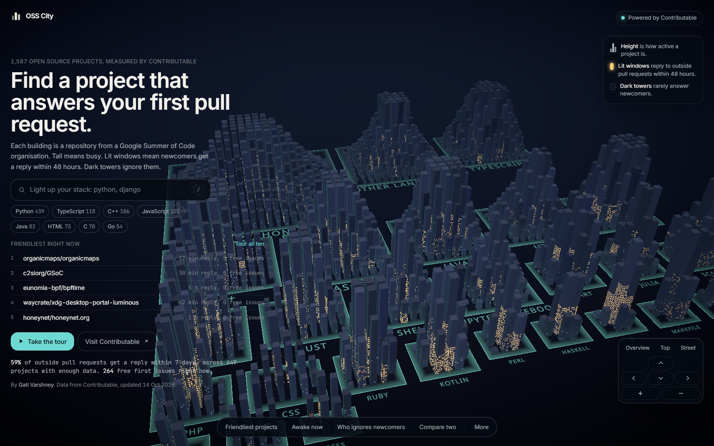

# OSS City

Every open source project measured by [Contributable](https://contributable.vercel.app), built as a
night city you can fly through. Live at [osscity.vercel.app](https://osscity.vercel.app).



## How to read the city

One building per repository, about 1,600 of them, from organisations that have taken part in
Google Summer of Code.

- **Height** is activity: commits in the last 90 days and outside pull requests over the last year,
  on a log scale so a few giants do not flatten everyone else.
- **Lit windows** show the share of outside pull requests that got a human reply within 48 hours.
  A building with most windows lit answers newcomers fast.
- **Dark towers** are popular projects that rarely answer. A ghost town has at least 100 stars and
  at most a third of outside pull requests answered within a week.
- **Districts** group buildings by main language. Languages with fewer than eight repositories
  share a district called "Other languages".
- Buildings with fewer than five outside pull requests are drawn in a muted blue and read
  "Not enough data" everywhere. Contributable withholds reply figures below that sample, and so
  does the city.

Click a building for its card: first reply time, outside pull requests merged, free first issues,
the busiest reply hours in your time zone, the organisation and years, and a button that opens the
repository's page on Contributable.

## Modes

- **Tour the 10 friendliest**: a guided flight past the ten most welcoming projects, with a caption
  at each stop and a summary at the end. Arrow keys move, space pauses.
- **Ghost towns**: highlights popular projects that rarely answer newcomers.
- **Compare**: pick two buildings and see them side by side.
- **2D map**: the same plan on a flat canvas. Used automatically without WebGL, with reduced motion
  on, or on a weak device, and available any time.
- **Postcard**: saves the current view as a high resolution image with both marks.
- **List view**: the same data as an accessible, sortable table at `/list`.

Keyboard: `/` search, `T` tour, `G` ghost towns, `C` compare, `M` map, `R` reset, `P` postcard,
arrows or `WASD` fly, `Q` and `E` turn, `+` and `-` zoom, `Esc` close.

## Where the data comes from

OSS City has no data pipeline of its own and never calls GitHub. Contributable measures every
repository and publishes an index on the `data` branch of
[gativarshney/contributable](https://github.com/gativarshney/contributable). The flow is:

1. Contributable's sweep runs four times a day in GitHub Actions and publishes `index.json`.
2. OSS City's server reads that file through `/api/city`, keeps only the fields the city draws,
   and caches the result for fifteen minutes.
3. The browser fetches `/api/city`, lays out the districts, and draws the buildings.

So the city is never more than fifteen minutes behind Contributable, and the "updated" date on the
first screen is the date Contributable generated the index. Organisation names come from
Contributable's public API. Every number shown is one Contributable already publishes; the city
only maps them to height, light and colour.

Fields used: activity (commits and pull requests), first reply time, share answered within 48
hours and 7 days, outside merge rate, free first issues, language, programs and years, reply hours
by hour of day, and stars.

## Running it

```bash
npm install --legacy-peer-deps
npm run dev
```

Then open http://localhost:3000. The dev server reads Contributable's live index. To point at a
different copy, set `CONTRIBUTABLE_DATA_URL` (a base URL that serves `index.json`) and
`CONTRIBUTABLE_API_URL` (a base URL that serves `orgs`).

Checks:

```bash
npm run lint
npm run typecheck
npm test
npm run test:e2e
```

Unit tests cover the mapping from metrics to height, light and colour, the district layout, search,
the first screen numbers and the time zone shift. The end-to-end test builds the site, serves a
recorded slice of the index from `e2e/fixtures`, and walks through load, search, a card and the
"Open in Contributable" link. CI runs all of it on every push.

To refresh the poster frame, the share card background and the README screenshot after a visual
change, run the dev server and then:

```bash
node scripts/capture.mjs
```

## Links between the two sites

- `osscity.vercel.app/r/<owner>/<repo>` redirects to that repository's page on Contributable.
- Contributable links back to the city from its navigation, and `contributable.vercel.app/city`
  redirects here.

## Licence

MIT. Data is Contributable's, published under CC BY 4.0.
